<div align="center">


# Everport

**A public URL for each local port that never changes.**<br>
Served from your own Cloudflare account. Managed from the CLI or VS Code.

[](https://github.com/ptduy14/everport/actions/workflows/ci.yml)
[](LICENSE)

[Quick start](#quick-start) · [How it works](#how-it-works) · [Install](#install) · [Use](#use) · [Good to know](#good-to-know)

</div>

---

Webhook senders, OAuth providers and AI connectors store the URL you give them. When your tunnel gets a new address on every run, you re-register it everywhere, by hand, every time.

Everport gives each local service its own address that **stays the same**, even after you restart your computer. Register it with Stripe, GitHub, Google or an AI connector once, and never paste a new one.

There is no Everport server. The relay is a small Worker that runs in **your** Cloudflare account, and nothing sits in front of your content: no warning page.

<!-- TODO(media): terminal recording of the quick start (login, add, open the URL) -->
<!-- TODO(media): screenshot or GIF of the Everport view in VS Code -->

## Quick start

You need a [Cloudflare account](https://dash.cloudflare.com/sign-up) (the free plan is enough) and Node.js 22 or newer.

```bash
npm install -g everport
everport login            # opens your browser; Cloudflare's own tool handles the login
everport add 3000         # the first run creates the relay, then prints the public URL
```

Open the printed address: it serves whatever runs on `http://127.0.0.1:3000`. After that, `everport down` and `everport up` stop and start everything, and every URL stays the same.

## Why Everport

Other free tunnels each get in the way of this job somewhere: the address changes, only one is free, a warning page sits in front of your content, or streaming breaks. Here is what Everport does differently, and what we measured.

- **Several fixed addresses, free, no domain.** Like `https://api-everport.<you>.workers.dev`. Each keeps its address across restarts, including after `down` and `up`.
- **No warning page.** In our test, scripts and iframes loaded from another site as from any other site. The same test against zrok's free plan returned an HTML warning page instead of the JavaScript.
- **Streaming works.** Server-sent events arrived tick by tick: 15 ticks over a 45 s stream, none cut. Behind Cloudflare Quick Tunnel the same kind of stream arrived all at once at the end.
- **Quick to come back.** `down` then `up` took about 1 s in our runs (0.6 s to 1.3 s on GitHub Actions, 1.2 s on Windows; one run each, so treat it as a rough idea). If a preview is lost on Cloudflare, `up` recreates it at the same address.
- **Keeps running after you close VS Code or the terminal.** A small background agent holds the tunnels up. In our runs tunnels kept answering after VS Code exited.
- **Your account, your quota, your data.** Nothing to sign up for besides Cloudflare, and no telemetry is sent.
- **CLI and VS Code extension** with the same actions: add, start, stop, health check, doctor.

|                         | Several fixed URLs, free       | Warning page in front of content                | Streaming (SSE)                         |
| ----------------------- | ------------------------------ | ----------------------------------------------- | --------------------------------------- |
| **Everport**            | Yes, no domain                 | None                                            | Tick by tick                            |
| ngrok (free plan)       | One dev domain (docs)          | Yes, visitors click through (docs)              | Not checked                             |
| Cloudflare Quick Tunnel | No, a new URL every run (docs) | None                                            | Held back, arrives all at the end       |
| zrok.io (free plan)     | Yes                            | Yes, broke scripts and iframes from other sites | Tick by tick (measured behind a Worker) |
| Tailscale Funnel        | Up to 3 public ports (docs)    | Not checked                                     | Not checked                             |

<sub>Cells without a note come from our own runs in November 2026 (one run each, zrok with an older client). "(docs)" means the vendor's documentation, not our test. "Not checked" means we have not looked. Products change; check before you decide. Everport's own limits are under [Good to know](#good-to-know).</sub>

## How it works



- The first `everport add` creates a small relay **Worker** in your account, then one **preview** per tunnel. A preview is a named copy of the Worker with its own address.
- The **agent** opens one outbound WebSocket per tunnel. Public requests reach Cloudflare, travel down that socket, are replayed against your local port, and the response streams back.
- Your computer only calls **out**: no port is opened and no firewall rule is needed.

More detail: [docs/ARCHITECTURE.md](docs/ARCHITECTURE.md).

## Install

**CLI** (needs Node.js 22 or newer):

```bash
npm install -g everport
```

The package has no runtime dependencies. It holds the CLI (`everport`, alias `ep`), the background agent and the relay Worker. The first command that talks to Cloudflare downloads a pinned version of Cloudflare's `wrangler` tool through `npx`, which can take a minute once.

**VS Code extension:** search for "Everport" in the Extensions view (publisher `everport-dev`), or run:

```bash
code --install-extension everport-dev.everport-vscode
```

It needs VS Code 1.90 or newer and Node.js 22 or newer on your computer (it runs the agent and wrangler). If the editor cannot find Node.js, set `everport.nodePath`. It is also published on Open VSX.

**From source:**

```bash
git clone https://github.com/ptduy14/everport.git
cd everport && npm install
npm run build -w everport && npm pack -w everport     # makes everport-0.1.0.tgz
npm install -g ./everport-0.1.0.tgz
```

## Use

```bash
everport login                 # opens your browser; Everport never sees your credentials
everport add 3000              # a port, host:port, or a full URL; prints the public URL
everport add 5500 --label widgets
everport ls --health           # every tunnel, its state, and what answers at its public address
everport down                  # stop the agent; addresses are kept
everport up                    # start again, same addresses
everport rm widgets            # delete the tunnel and its preview from Cloudflare
```

| Command                               | What it does                                                                                   |
| ------------------------------------- | ---------------------------------------------------------------------------------------------- |
| `login`                               | Logs in to Cloudflare in your browser (runs `wrangler login`).                                 |
| `add <target> [-l, --label] [--copy]` | Adds a tunnel to a local service. The first one also creates the relay.                        |
| `up [--json]` / `down`                | Starts or stops the background agent and every enabled tunnel. `up` restores a lost preview.   |
| `ls` (`status`) `[--json] [--health]` | Lists tunnels. `--health` asks each public address who answers.                                |
| `start` / `stop <tunnel>`             | Turns one tunnel on or off. `<tunnel>` is its id or label.                                     |
| `rm` (`remove`) `<tunnel>`            | Removes the tunnel and its preview. The address stops working.                                 |
| `copy <tunnel>`                       | Copies the URL to the clipboard.                                                               |
| `doctor [--json]`                     | Checks Node, wrangler, login, the data folder and the relay, and says how to fix each failure. |

Results (URLs, tables, JSON) go to stdout; progress and errors go to stderr, so `--json` and pipes stay clean.

**Environment variables**

| Variable               | Meaning                                                                        |
| ---------------------- | ------------------------------------------------------------------------------ |
| `EVERPORT_DATA_DIR`    | Where Everport keeps its files.                                                |
| `EVERPORT_WORKER_NAME` | Name of the relay Worker (default `everport`); used when the relay is created. |
| `EVERPORT_DEBUG=1`     | Print stack traces for unexpected errors.                                      |

Files live in `%LOCALAPPDATA%\everport` on Windows, `~/Library/Application Support/everport` on macOS, and `$XDG_DATA_HOME/everport` or `~/.local/share/everport` on Linux.

**API token instead of a browser login** (for CI): set `CLOUDFLARE_API_TOKEN` and `CLOUDFLARE_ACCOUNT_ID`. If every call fails with Cloudflare error `9109` or `10000`, check that the token's start date is today or empty.

### VS Code

Open the Everport view in the Activity Bar to log in to Cloudflare, add a tunnel (from a picker of the ports that are listening), start and stop one or all, copy and open URLs, check health, run the doctor and show the log. The status bar shows how many tunnels are running.

| Setting                | Default | Meaning                                                                                                          |
| ---------------------- | ------- | ---------------------------------------------------------------------------------------------------------------- |
| `everport.startOnOpen` | off     | Start your enabled tunnels when VS Code opens. Off by default because starting makes your local services public. |
| `everport.nodePath`    | empty   | Path to a Node.js 22+ executable. Needed when VS Code starts without your shell's `PATH` (common on macOS).      |

## Good to know

- **Built on a Cloudflare beta.** Tunnels are [Workers Previews](https://developers.cloudflare.com/workers/), which are in open beta. Cloudflare can change or stop them, and Everport does not control that. If they change, the plan is an explicit move to one Worker per tunnel, aimed at keeping the same hostnames; that plan is not implemented yet. See [docs/contingency.md](docs/contingency.md), and think twice before registering an Everport URL somewhere you cannot easily edit.
- **Your URLs are public.** Anyone who knows a URL can reach the service behind it, so do not expose a service that has no authentication. The address also contains your Cloudflare `workers.dev` subdomain.
- **Free plan limits.** According to Cloudflare's documentation at the time of writing (check the current numbers): 100,000 requests per day for Workers and for Durable Objects, and at most 100 previews per Worker. Past a limit, requests fail until 00:00 UTC. Quota use over long sessions has not been measured.
- **AI connectors.** Everport was designed so that connectors such as ChatGPT can load your widgets and pages from a fixed address. That use has **not been verified** inside ChatGPT's sandboxed iframe yet.
- **Not supported yet:** WebSockets of your own app (for example hot reload), streaming uploads, request flow control. Cancelling a request halfway can take about 30 seconds to reach your local service.
- **Your secrets.** The relay secret is kept in a `relay-secret` file in the data folder, readable only by you on macOS and Linux. On Windows it is protected only by your user folder's permissions. Everport never reads or stores wrangler's login, and the agent's control API listens on `127.0.0.1` only.
- **A development tool, not for production.** You are responsible for following Cloudflare's terms. Everport comes with no warranty ([MIT license](LICENSE)).

## Troubleshooting

Start with `everport doctor`: it checks each piece and prints a fix for every failure.

- **"You are not logged in to Cloudflare"**: run `everport login`, or set the API token variables.
- **The URL answers `503 tunnel offline`**: the agent is not running. Run `everport up`.
- **A tunnel shows `missing`**: its preview was lost on Cloudflare. `everport up` recreates it at the same address.
- **A tunnel shows a health of `mismatch`**: another Worker answers at that address. Remove the tunnel and add it again.
- **The first command takes a minute**: wrangler is downloaded once through `npx`, then cached.
- **VS Code says it needs Node.js 22**: install it, or set `everport.nodePath` to the executable.

## Contributing

Bug reports and pull requests are welcome: see [CONTRIBUTING.md](CONTRIBUTING.md). For a security problem, see [SECURITY.md](SECURITY.md) and do not open a public issue. Never paste tokens or the contents of `relay-secret`.

## License

[MIT](LICENSE). Everport is unofficial and is not affiliated with, endorsed by or sponsored by Cloudflare. Cloudflare, Workers and Durable Objects are trademarks of Cloudflare, Inc.
