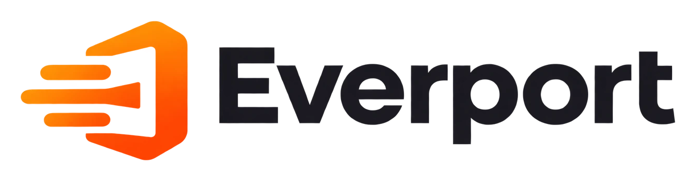

<div align="center">

<h1 align="center">
  
</h1>

**A public URL for each local port that never changes.**<br>
Served from your own Cloudflare account. Managed from the CLI or VS Code.

[](https://github.com/ptduy14/everport/actions/workflows/ci.yml)
[](https://github.com/ptduy14/everport/blob/main/LICENSE)

<!-- TODO(publish): after npm, the Marketplace and Open VSX are live, add these badges next to the two above, then check each one renders:
[](https://www.npmjs.com/package/everport)
[](https://marketplace.visualstudio.com/items?itemName=everport-dev.everport-vscode)
[](https://open-vsx.org/extension/everport-dev/everport-vscode)
-->

[Quick start](#quick-start) · [How it works](#how-it-works) · [Install](#install) · [Use](#use) · [Good to know](#good-to-know) · [Reference](https://github.com/ptduy14/everport/blob/main/docs/reference.md)

</div>

---

Webhook senders, OAuth providers and AI connectors store the URL you give them. When your tunnel gets a new address on every run, you re-register it everywhere, by hand, every time.

Everport gives each local service its own address that **stays the same**, even after you restart your computer. Register it once with Stripe, GitHub, Google or an AI connector and never paste a new one. There is no Everport server: the relay is a small Worker in **your** Cloudflare account.

<!-- TODO(media): terminal recording of the quick start (login, add, open the URL) -->
<!-- TODO(media): screenshot or GIF of the Everport view in VS Code -->

## Quick start

You need a [Cloudflare account](https://dash.cloudflare.com/sign-up) (the free plan is enough) and Node.js 22.12 or newer.

```bash
npm install -g everport
everport login            # opens your browser; Cloudflare's own tool handles the login
everport add 3000         # the first run creates the relay, then prints the public URL
```

Open the printed address: it serves whatever runs on `http://127.0.0.1:3000`.

## Why Everport

- **A fixed address for each service.** Several at once, free, no domain needed.
- **No warning page** in front of your content. In our tests, scripts and iframes loaded from other sites as normal.
- **Keeps running when you close the terminal or VS Code.** A small background agent holds the tunnels up.
- **Your Cloudflare account, your quota.** No Everport server sits in the middle.
- **A CLI and a VS Code extension** with the same actions.

How it compares with ngrok, Cloudflare Quick Tunnel, zrok and Tailscale Funnel, and where each statement comes from: [docs/comparison.md](https://github.com/ptduy14/everport/blob/main/docs/comparison.md).

## How it works


1. A caller (a webhook, a browser, an AI connector) requests your public address.
2. A Worker in your Cloudflare account, one per tunnel, passes the request to a Durable Object.
3. The Everport agent on your computer has already opened a WebSocket to that Durable Object, so the request travels down it.
4. The agent calls your local service, and the response goes back the same way.

Your computer only connects **out**: no port is opened and no firewall rule is needed. More detail: [docs/ARCHITECTURE.md](https://github.com/ptduy14/everport/blob/main/docs/ARCHITECTURE.md).

## Install

```powershell
npm install -g everport
```

Needs Node.js 22.12 or newer. The package has no runtime dependencies: it holds the CLI (`everport`, alias `ep`), the background agent and the relay Worker. A VS Code extension with the same actions is published separately as "Everport" (publisher `everport-dev`).

## Use

```bash
everport login                 # opens your browser; Everport never sees your credentials
everport add 3000              # a port, host:port, or a full URL; prints the public URL
everport add 5500 --label widgets
everport ls --health           # every tunnel, its state, and what answers at its public address
everport down                  # stop the agent; addresses are kept
everport up                    # start again, same addresses
everport rm widgets            # delete the tunnel and its preview from Cloudflare
```

| Command                   | What it does                                                       |
| ------------------------- | ------------------------------------------------------------------ |
| `login`                   | Logs in to Cloudflare in your browser.                             |
| `add <target>`            | Adds a tunnel to a local service. The first one creates the relay. |
| `up` / `down`             | Starts or stops the background agent and every enabled tunnel.     |
| `ls`                      | Lists tunnels; `--health` asks each address who answers.           |
| `start` / `stop <tunnel>` | Turns one tunnel on or off.                                        |
| `rm <tunnel>`             | Removes the tunnel and its preview. The address stops working.     |
| `copy <tunnel>`           | Copies the URL to the clipboard.                                   |
| `doctor`                  | Checks your setup and says how to fix each problem.                |

`ls` shows each tunnel as `online`, `stopped` (you turned it off), `offline` (the background agent is not running), `missing` (gone from Cloudflare; `up` brings it back at the same address) or `error` (with a fix printed under the table).

After a reboot, run `everport up` (or click **Start All** in VS Code) to start your tunnels again. Something not working? Start with `everport doctor`.

Options, environment variables, the data folder, CI tokens and troubleshooting are in the [reference](https://github.com/ptduy14/everport/blob/main/docs/reference.md).

### VS Code

Open the Everport view in the Activity Bar to log in to Cloudflare, add a tunnel from a picker of the ports that are listening, start and stop tunnels, copy and open URLs, check health and run the doctor. The status bar shows how many tunnels are online and which need attention. **Show Log** opens the Everport output channel, with a fix for each error.

Two settings matter: `everport.startOnOpen` starts your enabled tunnels when VS Code opens (off by default, because starting makes your local services public), and `everport.nodePath` points to a Node.js 22.12+ executable. Everport finds Node.js on your `PATH` and in the folders of fnm, nvm and Volta; if yours is elsewhere, run **Everport: Select Node.js**.

## Good to know

- **Built on a Cloudflare open beta.** Tunnels are Cloudflare [Workers Previews](https://developers.cloudflare.com/workers/previews/), and Cloudflare's own `wrangler preview` command is labelled open beta. Cloudflare can change or retire them, and Everport does not control that. If they change, the plan is an explicit move to one Worker per tunnel, aimed at keeping the same hostnames; it is not implemented yet. See [docs/contingency.md](https://github.com/ptduy14/everport/blob/main/docs/contingency.md), and think twice before registering an Everport URL somewhere you cannot easily edit.
- **Your URLs are public.** Anyone who knows a URL can reach the service behind it, so do not expose a service that has no authentication. The address also contains your Cloudflare `workers.dev` subdomain.
- **Free plan limits.** According to Cloudflare's documentation (check the current numbers): 100,000 requests per day for Workers and for Durable Objects, and 100 previews per Worker. Past a limit, requests fail until 00:00 UTC. See the [limits](https://github.com/ptduy14/everport/blob/main/docs/reference.md#cloudflare-limits); quota use over long sessions has not been measured.
- **AI connectors.** Everport was designed so that connectors such as ChatGPT can load your widgets and pages from a fixed address. We tested it in ChatGPT: an MCP app loaded its widget bundle from an Everport URL inside ChatGPT's sandboxed iframe (November 2026, one setup).
- **Not supported yet:** WebSockets of your own app (for example hot reload), streaming uploads, request flow control.
- **Privacy.** Everport's own code sends no usage data. Cloudflare's wrangler, which Everport runs, has its own setting for that; see [Privacy and security](https://github.com/ptduy14/everport/blob/main/docs/reference.md#privacy-and-security).
- **A development tool, not for production.** You are responsible for following Cloudflare's terms. Everport comes with no warranty ([MIT license](https://github.com/ptduy14/everport/blob/main/LICENSE)).

## Contributing

Bug reports and pull requests are welcome: see [CONTRIBUTING.md](https://github.com/ptduy14/everport/blob/main/CONTRIBUTING.md). For a security problem, see [SECURITY.md](https://github.com/ptduy14/everport/blob/main/SECURITY.md) and do not open a public issue. Never paste tokens or the contents of `relay-secret`.

## License

[MIT](https://github.com/ptduy14/everport/blob/main/LICENSE). Everport is unofficial and is not affiliated with, endorsed by or sponsored by Cloudflare. Cloudflare, Workers and Durable Objects are trademarks of Cloudflare, Inc.
